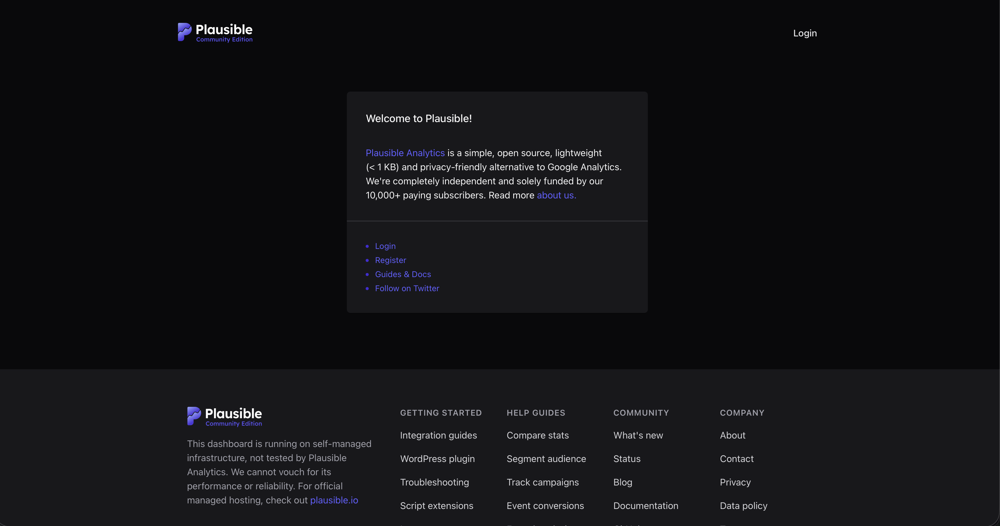
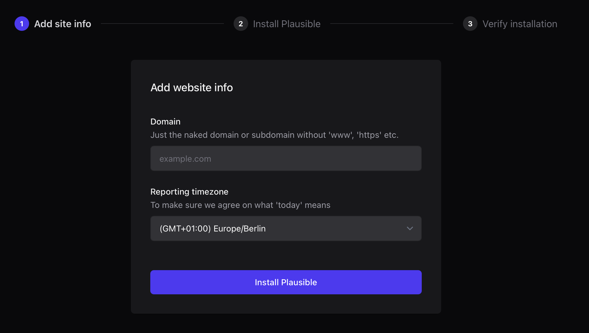
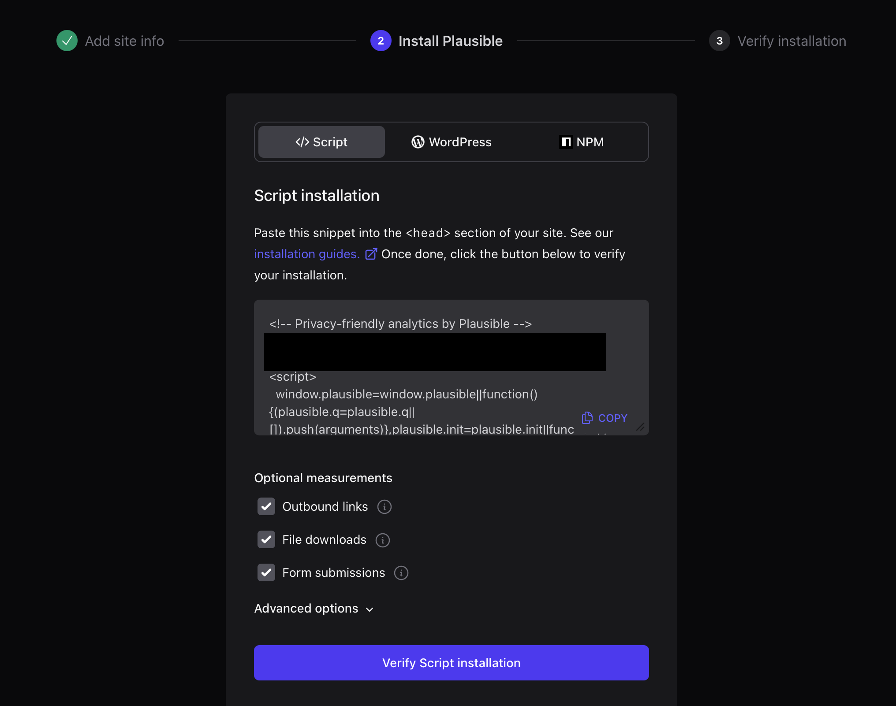
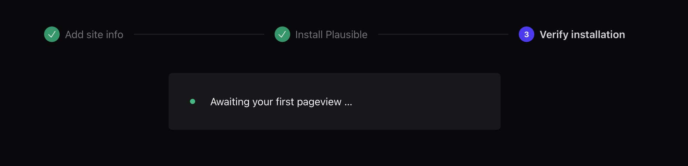
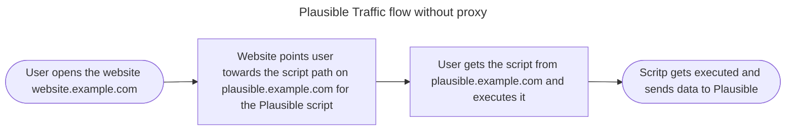
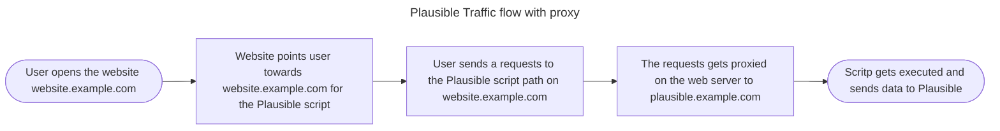

# Plausible analytics setup guide for AlmaLinux 10

This guide provides the steps to install and set up **Plausible analytics - CE** on an AlmaLinux 10 system using Docker. The targeted version for this setup is ``v3.2.1``. If you want to install any other version you should just be able to change the version number in the installation step.

!!! note
    Please be aware that there is no official non-Docker setup. For more information refer to the [official Plausible GitHub page](https://github.com/plausible/community-edition).

## Requirements

The Plausible setup is Docker-based and therefore simple but there are still a few things required for a smooth installation.

- [x] A system running AlmaLinux 10 with
    - [x] SSH access
    - [x] Root permissions
    - [x] Internet access
    - [x] At least 2 GB of RAM 
- [x] A basic understanding of docker and the Linux shell
- [x] A domain which can be used to host Plausible
- [x] A DNS Record for the domain which points to the future Plausible instance 

## Setup

### System update

Before you can start with the actual installation, setup, and integration of Plausible you need to ensure that you are logged into the system and it is up to date. Once you are logged into the system using SSH update the system.

```bash
sudo dnf update -y
```

This ensures that the system is fully up to date. If required reboot the system and log in again once it is up.

### Installing prerequisites

Since the installation requires Docker, please refer to the [AlmaLinux 10 Setup Guide](../../infra-mgmt/linux-admin/rhel-alma/almalinux_setup.md#installing-docker) for these steps. Once you are done with the docker installation the only needed prerequisite left is git.

```bash
sudo dnf install git -y
```

### Installing Plausible

To install the most recent version of Plausible, please visit the [Plausible CE GitHub Page](https://github.com/plausible/community-edition/) and search for the last published version branch. Once you have the version you can download the repository using the version branch.

```bash
git clone -b v3.2.1 --single-branch https://github.com/plausible/community-edition plausible-ce
```

Once you downloaded the repository, navigate into the newly created directory `plausible-ce` and verify that the following files exist.

```bash
cd plausible-ce
ls -1
```

This should output the following:

```txt
clickhouse
compose.yml
LICENSE
README.md
```

Before you can start the Plausible container the environment and docker compose file need to be set up. First create the secret key base which is used to create the secret keys your instance uses. Copy the key and create the `.env` file.

```bash
openssl rand -base64 48
nano .env
```
The `.env` contains the base settings for the Plausible instance. Make sure the following four variables are inside your environment file. 

!!! note
    Choosing the port 80/443 enables automatic Let's Encrypt TLS certificate issuance. You can choose different values if you want to run Plausible behind a reverse proxy. You need to have a DNS Record set up that points to the server or this certificate creation won't work.

```env
BASE_URL=https://plausible.example.com
SECRET_KEY_BASE=<secretkey>
HTTP_PORT=80
HTTPS_PORT=443
```

!!! warning
    When choosing a domain you want to host your Plausible instance on please be aware that names that contain *analytics* or similar terms are frequently blocked by ad blockers. You can still use for example analytics.example.com without it being blocked by implementing a reverse proxy setup which obscures the Plausible domain with the domain name of the web server itself. Plausible offers a straight setup for common proxies [here](https://plausible.io/docs/proxy/introduction).


Now you can configure the compose file. Create the file and edit it.

```bash
nano compose.override.yml
```

Make sure you add the following content to the file, then save it.


```yml
services:
    plausible:
        ports:
            - 80:80
            - 443:443
```

With all preparation done you can start the docker container and log in to the website `https://plausible.example.com`.

```bash
sudo docker compose up -d
```

Verify if the container is up and running correctly by checking the website. You should be greeted by Plausible login screen.



### Setting up Plausible

Before you can set up the first integration you need to create a Plausible account. Click `Register` within the **Welcome to Plausible** square, create a Plausible account and log into your Plausible instance afterwards.

Once you logged into your instance you are prompted to onboard your first website. Enter the domain name of your website and which time zone should be used.



Now you have to install/integrate the Plausible script generated for your Plausible instance and target website specifically into the site.

You can choose between 3 different deployment options:

- Manually adding the script into the `<head>` section of your website
- Installing the WordPress Plugin on your website, if using WordPress
- Installing the script via the `npm` package manager

!!! tip
    Make sure to select all optional measurements that are relevant to your website.



Once you are done with the integration return to the setup page and click **Verify**.
Now your Plausible instance is waiting for the first connection. Trigger it yourself by accessing the website where the integration is set  up. As soon as Plausible gets connected by the script, which is executed by anyone accessing your website, the verification and setup is done.



### Masking Plausible

As mentioned before, to avoid the Plausible script being blocked by adblockers and other similar tools, you can use a proxy like *nginx* to hide the Plausible instance domain behind the websites own.



Adblockers tend to look at the domain where the script needs to be retrieved from and block the download of the script. This way it won't be executed and Plausible can't see these users connecting. The proxy setup solves this by hiding Plausible domain.

!!! note
    The script path is the App/Website-unique path on your Plausible instance, for example *https://plausible.example.com/js/pa-XXXXXXX.js*.



In this case the user never gets to see where the script is actually from. All he can see is that script from *https://website.example.com/js/script.js* instead from *https://plausible.example.com/js/pa-XXXXXX.js*.

To set up this scenario follow these 3 steps:

1. Get the Plausible snippet that you had to integrate into your website
2. Update your nginx configuration of your website with a redirect for 2 specific paths
3. Adjust the deployed script snippet on your website to reflect the nginx change.

<!-- vale off -->
??? example "nginx example configuration"
    ```nginx
    # Cache for the Plausible script. The directory must exist and be writable by the nginx user.
    proxy_cache_path /var/run/nginx-cache/jscache levels=1:2 keys_zone=jscache:100m inactive=30d use_temp_path=off max_size=100m;

    server {
        listen 443 ssl;
        server_name website.example.com;

        ssl_certificate     /etc/letsencrypt/live/website.example.com/fullchain.pem;
        ssl_certificate_key /etc/letsencrypt/live/website.example.com/privkey.pem;

        # Remove if a resolver is already set
        resolver 9.9.9.9;
        set $plausible_script_url https://plausible.example.com/js/pa-XXXXXXX.js;   # Script path from step 1
        set $plausible_event_url  https://plausible.example.com/api/event;

        location = /js/script.js {
            proxy_pass            $plausible_script_url;
            proxy_set_header      Host plausible.example.com;
            proxy_ssl_server_name on;

            proxy_cache           jscache;
            proxy_cache_valid     200 5m;
            proxy_cache_use_stale updating error timeout invalid_header http_500;
        }

        location = /api/event {
            proxy_pass            $plausible_event_url;
            proxy_set_header      Host plausible.example.com;
            proxy_ssl_server_name on;
            proxy_buffering       on;
            proxy_http_version    1.1;

            proxy_set_header      X-Forwarded-For   $proxy_add_x_forwarded_for;
            proxy_set_header      X-Forwarded-Proto $scheme;
            proxy_set_header      X-Forwarded-Host  $host;
        }

        location / {
            # Your existing website configuration
        }
    }
    ```
<!-- vale on -->

??? example "script snippet example for proxy scenario"

    ```html
    <script async src="/js/script.js"></script>
    <script>
    window.plausible=window.plausible||function(){(plausible.q=plausible.q||[]).push(arguments)},plausible.init=plausible.init||function(i){plausible.o=i||{}};
    plausible.init({
        endpoint: "/api/event"
    })
    </script>
    ```